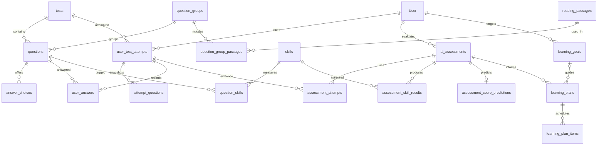

# Thiết kế database hệ thống luyện thi TOEIC ứng dụng AI

## Phạm vi và cách sử dụng

Thiết kế PostgreSQL cho Listening/Reading Part 1–7, dựa trên database và backend hiện có. File `schema_ai.sql` là bản khởi tạo **database trống**, không phải migration cho database đang sử dụng. `schema.sql` và các file sample cũ được giữ lại để đối chiếu.

```powershell
psql -h localhost -U postgres -d toeic_ai -v ON_ERROR_STOP=1 -f toeic_be/database/schema_ai.sql
psql -h localhost -U postgres -d toeic_ai -v ON_ERROR_STOP=1 -f toeic_be/database/seed_ai.sql
```

Tạo database `toeic_ai` trống trước khi chạy. Script schema có transaction: lỗi thì không giữ lại phần schema tạo dở. Không chạy thêm `schema.sql` cũ vào database mới.

## Vấn đề đã thấy ở bản cũ

- Hai bộ `CREATE TABLE` trùng tên bị ghép vào cùng file; có đoạn `CREATE INDEX idx_vocabulary_- 1. Users table` và `); ON vocabulary(topic_id);` sai cú pháp.
- `vocabulary` tham chiếu `vocabulary_topics` trước khi bảng này được tạo.
- Hai phiên bản không thống nhất các cột `question_type`, `score`, `target_score` và kiểu `topic_id`. Backend đang dùng `question_type`, `score` và `reading_passages.image_url`.
- Chưa có ràng buộc một thống kê/người dùng hoặc một đáp án/câu hỏi/lượt thi.
- Chưa có dữ liệu kỹ năng, bằng chứng đầu vào, phiên bản mô hình và lịch sử đánh giá năng lực.
- Các file sample cũ dùng topic dạng chữ, ID người dùng/đề cố định; `sample_test_attempts.sql` còn ghi thời gian theo giây trong khi backend lưu phút. Không nạp trực tiếp chúng vào bản mới.

## Các nhóm bảng

| Nhóm | Bảng | Vai trò |
|---|---|---|
| Tài khoản | `User`, `user_stats` | Đăng nhập, hồ sơ, thống kê tổng hợp |
| Động lực học | `achievements`, `user_achievements`, `study_sessions` | Thành tích, XP, lịch sử học |
| Từ vựng | `vocabulary_topics`, `vocabulary` | Chủ đề và ngân hàng từ vựng |
| Ôn tập | `srscard`, `srs_reviews` | Lịch ôn cách quãng và kết quả mỗi lần ôn |
| Ngữ liệu | `reading_passages`, `listening_materials` | Bài đọc, ảnh, audio, transcript |
| Nhóm câu hỏi | `question_groups`, `question_group_passages` | Câu hỏi chung ngữ liệu; một nhóm có nhiều bài đọc |
| Đề thi | `tests`, `questions`, `answer_choices` | Đề, câu hỏi, lựa chọn và đáp án |
| Làm bài | `user_test_attempts`, `attempt_questions`, `user_answers` | Lượt thi, bản chụp câu hỏi đã phát, câu trả lời |
| Kỹ năng | `skills`, `question_skills` | Nhãn như suy luận, ý chính, từ loại, thì động từ; quan hệ nhiều–nhiều |
| Mục tiêu | `learning_goals` | Điểm đích, ngày đích, thời lượng học mỗi ngày |
| Đánh giá AI | `ai_assessments`, `assessment_attempts` | Lần đánh giá, các lượt thi làm bằng chứng, input/output, model và phiên bản |
| Kết quả AI | `assessment_skill_results`, `assessment_score_predictions` | Năng lực từng kỹ năng, độ tin cậy, điểm dự đoán |
| Luyện tập cá nhân | `learning_plans`, `learning_plan_items` | Kế hoạch, nội dung được gợi ý, lý do và trạng thái hoàn thành |

Tổng cộng 28 bảng. View `latest_user_skill_assessments` lấy kết quả hoàn tất gần nhất theo từng người học và kỹ năng; bảng kết quả gốc giữ đầy đủ lịch sử.

## Quan hệ chính



## Luồng đánh giá năng lực

1. Quản trị viên nhập câu hỏi, đáp án và gắn kỹ năng. Một câu có thể đánh giá nhiều kỹ năng; `weight` là trọng số đóng góp, thuật toán cần chuẩn hóa khi tổng hợp.
2. Khi bắt đầu làm bài, backend tạo lượt thi và ghi **mọi câu được phát** vào `attempt_questions`, kể cả câu người học sẽ bỏ trống. `question_snapshot` lưu nội dung, đáp án, lựa chọn, nhãn kỹ năng và ngữ liệu tại thời điểm đó. Không gửi đáp án trong snapshot về trình duyệt khi đang thi.
3. Backend chấm đáp án từ snapshot và lưu `user_answers`; câu chưa trả lời được xác định từ tập câu đã phát. Các tổng đúng/sai và thời gian phải được tính bằng chương trình, không để mô hình ngôn ngữ tự đếm.
4. Tạo `ai_assessments` ở trạng thái `pending`, lưu phiên bản model/prompt/features và input đã tổng hợp. Gắn tất cả lượt thi làm bằng chứng vào `assessment_attempts`. Không đưa mật khẩu, email hoặc thông tin hồ sơ không cần thiết vào input.
5. Worker nhận việc, chuyển sang `running`, đánh giá từng kỹ năng; lưu kết quả và hoàn tất trong cùng transaction. Thiếu bằng chứng thì dùng `insufficient_data` và `mastery_score = NULL`, không kết luận người học yếu chỉ vì chưa làm câu hỏi kỹ năng đó.
6. Nếu có phương pháp dự đoán đã được kiểm chứng, lưu điểm Listening/Reading trong `assessment_score_predictions`. Điểm này là **ước lượng của hệ thống**, không phải điểm thi chính thức. `confidence` chỉ có ý nghĩa khi được tính/hiệu chuẩn; có thể NULL nếu chưa có phương pháp đáng tin cậy.
7. Sinh `learning_plans` và các mục luyện tập theo kỹ năng cần cải thiện; mỗi mục có lý do. Các lượt làm bài tiếp theo tạo đánh giá mới để theo dõi tiến bộ.

Ví dụ: kết quả 4/10 câu về từ loại tạo bằng chứng cho kỹ năng `reading_word_form`. AI có thể giải thích lỗi và đề xuất bài luyện từ loại; tỷ lệ đúng 40% không tự động đồng nghĩa `mastery_score = 40` nếu chưa xét độ khó, số mẫu và lịch sử.

## Quy ước và ràng buộc

- PK/FK và UNIQUE bảo vệ quan hệ; các FK ghép bảo đảm bằng chứng, mục tiêu và kế hoạch thuộc đúng người học của đánh giá.
- Điểm năng lực: 0–100; confidence: 0–1; NULL biểu thị chưa xác định. `User.current_level` là cấp độ gamification, không phải năng lực TOEIC.
- `user_test_attempts.score` được giữ để tương thích backend; phải kiểm tra công thức hiện tại trước khi hiển thị là điểm TOEIC. Không trộn với điểm dự đoán AI.
- Giữ đơn vị cũ: thời gian lượt thi và `user_stats.total_study_time` theo phút; thời gian từng câu và ôn tập theo giây. Các trường mới có đơn vị trong tên.
- Timestamp của nhóm bảng cũ được giữ để tương thích; bảng mới dùng TIMESTAMPTZ. Khi chuyển dữ liệu cũ, cần xác định timezone gốc trước khi chuyển đổi.
- Một người chỉ có một mục tiêu `active`; một lượt thi chỉ có một dòng đáp án cho mỗi câu. Dùng UPSERT để tránh lỗi khi lưu đáp án đồng thời.
- `questions.correct_answer` là nguồn đáp án chính ở ngân hàng; `answer_choices.is_correct` được giữ do backend cũ sử dụng. Backend phải cập nhật đồng bộ và kiểm tra đáp án tồn tại trong choices trước khi xuất bản đề.
- Không xóa/sửa nội dung đề đã có lượt thi để thay đổi lịch sử; dùng bản chụp khi chấm/xem lại. FK ngăn xóa nhiều bản ghi đã được tham chiếu. Bản chụp cũng cần giữ ngữ liệu/URL có phiên bản ổn định.

## Các phần backend cần nối vào thiết kế

DDL bổ sung cấu trúc lưu trữ, chưa tự triển khai AI. Cần thêm API/worker và các quy tắc nghiệp vụ sau:

- Ghi snapshot lúc bắt đầu thi; chấm và xem lại từ snapshot. Backend cũ hiện đọc câu hỏi đang có trong đề nên chưa tận dụng bảng này.
- Kiểm tra câu trả lời thuộc tập câu đã phát và lượt thi thuộc người dùng đăng nhập. Chưa thêm FK bắt buộc từ `user_answers` sang `attempt_questions` để giữ luồng ghi cũ; bổ sung ràng buộc đó sau khi backend đã ghi snapshot đầy đủ.
- Kiểm tra số lượng câu, lựa chọn theo Part, sự thống nhất Part giữa nhóm/câu hỏi và thứ tự ngữ liệu khi xuất bản đề. Kiểm tra đầy đủ các lựa chọn trước khi tính đúng/sai.
- Đánh giá chỉ dùng lượt thi đã hoàn tất; giới hạn chuyển trạng thái, khóa kết quả AI hoàn tất và ngăn hai worker xử lý cùng job. Những quy tắc này chưa được trigger tự động thực thi.
- Chọn và kiểm chứng phương pháp đánh giá: baseline thống kê trước, sau đó thử mô hình năng lực/dự đoán; dùng LLM để giải thích và gợi ý. Lưu tập đánh giá và so sánh sai số trước khi tuyên bố độ chính xác.
- `srscard.content_id` là quan hệ đa hình kế thừa, chưa có FK đến từng loại nội dung. Cần kiểm tra ở service; chức năng grammar cần có ngân hàng ngữ pháp riêng nếu triển khai.
- `questions.test_id` vẫn là quan hệ một câu–một đề để phù hợp code cũ. Nếu cần tái sử dụng cùng câu qua nhiều đề, bổ sung `test_questions` và đổi các truy vấn liên quan trong một đợt nâng cấp riêng.

Khi nâng cấp database đang chạy: kiểm kê schema thực tế, sao lưu, xử lý dữ liệu trùng/NULL, chuẩn hóa topic và đơn vị thời gian, rồi viết migration theo trạng thái đó. Không thể suy ra chính xác database thực tế chỉ từ file schema cũ bị ghép trùng.

## Kiểm chứng

Đã thực thi schema trên PostgreSQL 17 tạm, nạp seed hai lần và chạy `verify_ai.sql` thành công. Kiểm tra gồm: luồng lượt thi → đánh giá → kế hoạch, chặn đáp án trùng, chặn số câu đúng vượt tổng câu, chặn bằng chứng/kế hoạch khác người học, chặn năng lực thiếu bằng chứng, cộng điểm dự đoán, chỉ lấy đánh giá hoàn tất mới nhất và chỉ cho phép một mục tiêu đang hoạt động.

Chạy lại trong database kiểm thử riêng:

```powershell
psql -h localhost -U postgres -d toeic_ai_check -v ON_ERROR_STOP=1 -f toeic_be/database/schema_ai.sql -f toeic_be/database/seed_ai.sql -f toeic_be/database/verify_ai.sql
```

Chưa kiểm thử tích hợp backend hoặc mô hình AI; chưa chạy migration lên database đang sử dụng.
